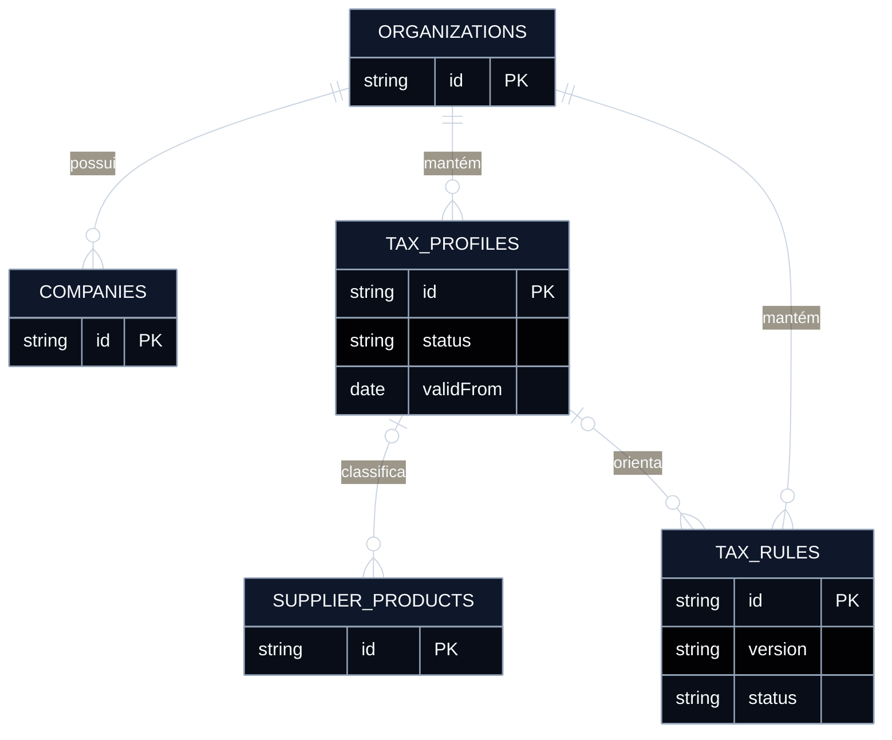
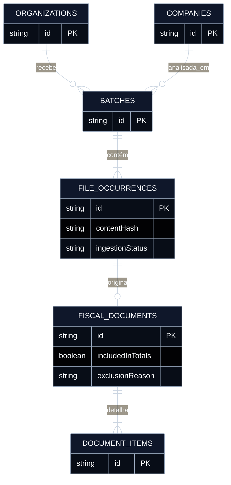
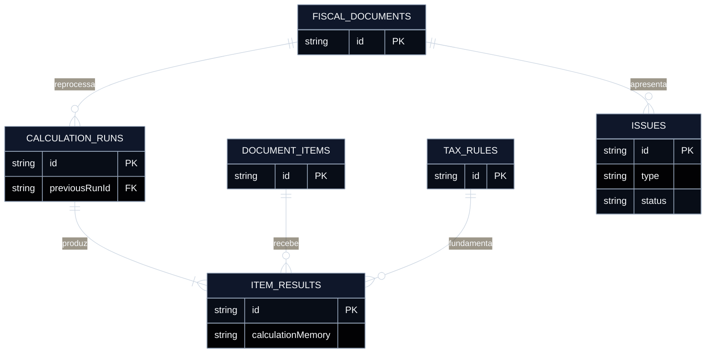
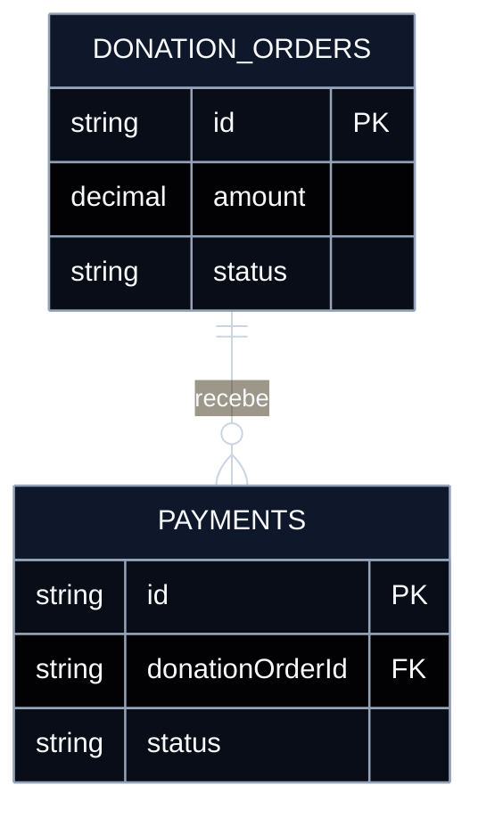

# Arquitetura do ContabiliNico

**Versão:** 0.4.0 — scaffold isolado da API de pagamentos

**Última atualização:** 24/10/2026

Este documento liga o vocabulário do [PRD](prd.md), as [jornadas](user-flows.md)
e o modelo de dados existente. A aplicação desktop continua processando XMLs,
cálculos, regras e histórico localmente. O backend acadêmico NestJS é uma nova
fronteira, limitada à criação de doações e à confirmação de pagamentos Stripe;
nenhum XML, dado fiscal ou resultado de cálculo é enviado a ele. Essa divisão
atende à stack exigida pela atividade sem transformar o processamento fiscal em
um serviço remoto.

## 1. Fontes e direcionadores

- `docs/prd.md`: atores, histórias, glossário e regras do produto.
- `docs/user-flows.md`: fluxos de importação e resolução de pendências.
- `docs/design-tokens.md`: decisões visuais da interface.
- `docs/modelo-de-dados.md` e `docs/decisoes-tecnicas.md`: persistência local e
  decisões fiscais já aprovadas.
- A atividade acadêmica fixa NestJS, Prisma e PostgreSQL e permite escolher
  React, Angular ou Vue para a interface.

Direcionadores mantidos: dados fiscais locais, cálculo determinístico e
reproduzível, regras versionadas, memória de cálculo auditável, falhas isoladas
por arquivo e nenhum serviço externo obrigatório para a conferência fiscal.

## 2. Stack

- **Interface desktop — Electron 38+ e Vue 3+:** a interface existente já usa Vue; a escolha reduz a troca de contexto e mantém o app instalável.
- **Linguagem — TypeScript 5.9 no desktop/pacotes e 6 na API:** ferramentas fixadas por aplicação; a adição da API não atualiza o compilador fiscal.
- **Backend — NestJS 12.2, ESM:** scaffold REST em `apps/api`, reservado ao fluxo independente de doações e pagamentos; atualmente expõe somente a demonstração do gerador.
- **Persistência da API — Prisma ORM 7.10 e PostgreSQL 16:** infraestrutura instalada; schema sem modelos e banco vazio na Atividade 08. Os dados de pagamento serão acrescentados por histórias com spec aprovada.
- **Persistência fiscal local — SQLite:** mantém empresas, lotes, XMLs normalizados, regras, cálculos e histórico na instalação.
- **Integração de pagamento planejada — Stripe API e webhooks:** processará a doação sem guardar dados de cartão e sem enviar dados fiscais; ainda não instalada.
- **Gerenciador de pacotes — pnpm 10+:** já organiza o monorepo e seus pacotes de domínio.
- **Testes — Vitest 3 no desktop/pacotes e Vitest 4.1 na API:** suítes separadas, orquestradas pela raiz; e2e da API usam Supertest.
- **Lint — Oxlint 1.89:** instalado na API; `pnpm lint` chama esse workspace sem ampliar o lint aos pacotes fiscais.

Decisões ratificadas na Atividade 08:

- Gerador oficial `@nestjs/cli` 12.0.10, com `--skip-git --skip-install --package-manager pnpm --no-observe`.
- ESM e Vitest vieram do template oficial; o TypeScript 6 da API permanece isolado do TypeScript 5.9 do desktop.
- SWC preserva os metadados de decorators nos testes NestJS; o transformador padrão do Vitest não preservava a injeção no próprio teste do gerador.
- O plugin de aliases do template foi removido: não há aliases na API e seu peer de TypeScript 5 era incompatível com o template TypeScript 6.
- `@nestjs/observe` não foi instalado; o comando e a dependência de deploy `@nestjs/mau` do template foram removidos, pois o deploy não faz parte desta etapa.
- O pnpm 10.32.1 e o frontend existente em `apps/desktop` são adaptações explícitas do roteiro npm + `apps/web`; não foi criado outro frontend.
- Node.js 24 LTS atualizado é a referência de desenvolvimento e dos workflows; o runtime embarcado do Electron permanece o da versão instalada do aplicativo.
- PostgreSQL 16 usa a porta local 5433 para evitar o PostgreSQL já existente na 5432; somente loopback é publicado.

Dependências presentes na API: NestJS, `@nestjs/config`, Prisma CLI,
`@prisma/client`, `@prisma/adapter-pg`, `pg` e `dotenv`. O cliente Prisma será
produzido quando existir o primeiro modelo aprovado. Swagger, DTOs de negócio,
`class-validator`, `class-transformer` e Stripe permanecem planejados.

Não há autenticação de usuário no MVP fiscal: a instalação local não possui
contas ou papéis, e a futura doação não criará uma conta. O futuro webhook
validará a assinatura do gateway.

## 3. Organização do repositório e camadas

O monorepo pnpm existente contém o aplicativo fiscal e o scaffold da API como
workspaces independentes. A API não importa os pacotes fiscais. Testes de
arquitetura verificam os imports e as dependências declaradas dessa fronteira.

A estrutura abaixo distingue a API já gerada do pacote de contratos ainda
planejado. O desktop existente mantém seu histórico anterior à revisão acadêmica.

```text
apps/
  desktop/            Electron, Vue, preload e processo principal
  api/                scaffold NestJS; futuro serviço de doações/pagamentos
packages/
  contracts/          contratos IPC existentes e tipos compartilhados seguros
  domain/             conceitos fiscais e estados independentes da interface
  nfe-parser/         inventário, segurança, parsing, XSD e normalização
  tax-engine/         seleção de regras e cálculo determinístico
  database/           persistência fiscal local em SQLite
  reporting/          modelo e exportação XLSX
  interchange/        importação e exportação de configurações
  payments/           PLANEJADO: contratos do fluxo de doação, sem dados fiscais
docs/                 PRD, jornadas, arquitetura e decisões
```

Fluxo fiscal: componente Vue → serviço da interface → IPC restrito → preload →
processo principal/workers → parser e domínio → motor fiscal → repositório SQLite
local → serviço de relatório. Componentes de interface não acessam o banco e não
falam diretamente com o servidor.

Fluxo de doação planejado: componente Vue → serviço de doações → API REST NestJS → módulo
de doações/pagamentos → serviço Stripe e repositório Prisma → PostgreSQL. O
webhook Stripe entra pelo módulo de pagamentos, valida a assinatura e registra o
evento de forma idempotente. A API recebe somente identificador do pedido, valor,
moeda, estado e identificadores do gateway.

A evolução da API seguirá portas e adaptadores: domínio e casos de uso
independentes de NestJS/Prisma/Stripe; portas para persistência e gateway;
adaptadores HTTP em controllers NestJS, persistência via Prisma e gateway Stripe.
Essas camadas de negócio só serão criadas com as primeiras specs aprovadas. No
scaffold atual, `AppController` e `AppService` são a demonstração `Hello World!`
do gerador; não há módulo, DTO, tabela ou operação de pagamento.

Os futuros DTOs validarão a entrada. `ValidationPipe`, filtro global,
interceptor e Swagger serão adicionados com as histórias correspondentes. O
servidor confirmará pagamentos por webhook; o desktop consultará o estado.
Indisponibilidade desse serviço não bloqueará o uso fiscal local.

Comandos da raiz: `pnpm dev` inicia o desktop; `pnpm dev:api` inicia apenas a API;
`pnpm test` executa os testes de ferramentas e todos os workspaces; `pnpm check`
agrega lint da API, tipagem, testes e os builds separados de API e desktop.
`pnpm db:up`, `pnpm db:validate` e `pnpm test:db` verificam o banco opcional da API.

Arquivos adicionados: `docker-compose.yml`, `apps/api/prisma.config.ts`,
`apps/api/prisma/schema.prisma`, testes de infraestrutura/fronteiras e workflows
`api.yml`/`explicacao.yml`. O Prisma 7.10 gerou `prisma7.config.ts`; ele foi
renomeado para o nome convencional `prisma.config.ts`, aceito pela CLI e usado
no roteiro. O cliente terá saída em `apps/api/generated/prisma`, ignorada pelo Git.

## 4. Frontend

Vue 3+ permanece como framework de interface, dentro do renderer Electron. A
escolha se apoia na interface já implementada e na experiência acumulada no
projeto. Vue Router organiza navegação e Pinia guarda somente estado
compartilhado entre telas. Regras fiscais, cálculos e acesso a persistência
continuam fora de componentes e stores.

Electron mantém `contextIsolation` habilitado e Node.js indisponível no renderer.
O preload expõe apenas operações IPC explicitamente tipadas. Para a futura doação, a
interface usará um serviço Vue dedicado que conversará com a API; telas fiscais
não receberão cliente ou credenciais do Stripe.

## 5. Dados e ambientes

Os dados fiscais e o histórico pertencem ao SQLite de cada instalação. O
PostgreSQL é reservado a pedidos de doação e pagamentos e permanece vazio nesta
etapa. Os dois armazenamentos não são mesclados nem sincronizados. Valores monetários são decimais exatos; o
estado `pago` só é confirmado por webhook válido. Uma repetição do evento não
cria uma segunda confirmação.

Ambientes da API:

- **Local:** PostgreSQL 16 no Compose exclusivo `contabilinico-payments-dev`, em `127.0.0.1:5433`; `DATABASE_URL` em `apps/api/.env` fora do Git. Volume próprio, sem acesso ao SQLite fiscal do aplicativo.
- **CI:** PostgreSQL 16 descartável no GitHub Actions; `DATABASE_URL` de teste é definida pelo workflow. Testes fazem conexão TCP e verificam a ausência de tabelas; a CLI Prisma também executa uma verificação sem alterar o banco.
- **Produção planejada:** Neon, região São Paulo; `DATABASE_URL` em secret da plataforma. Sem deploy ou credencial de produção nesta atividade.

O `.env.example` documenta a conexão descartável do Compose local. Credenciais
reais e futuras chaves do Stripe vivem fora do Git. `ConfigModule.forRoot({
isGlobal: true })` carrega o ambiente da API; `dotenv` carrega o ambiente da CLI
Prisma. Não existe migration nem `model` no schema desta etapa. XMLs, CNPJ,
regras, memória de cálculo e relatórios fiscais nunca são enviados à API.

### Glossário técnico e modelo conceitual

Os nomes em inglês descrevem entidades e contratos alvo. O esquema físico
SQLite preexistente mantém nomes em português documentados em
`modelo-de-dados.md`; a correspondência conceitual não renomeia migrations nem
dados instalados. Essa compatibilidade deve ser preservada ao implementar novos
contratos. Os diagramas representam o recorte acadêmico inicial; detalhes de
eventos e auditoria existentes continuam no modelo físico.

- **Organização — `organizations` (SQLite):** `id`, `name`, `installationId`.
- **Empresa — `companies` (SQLite):** `id`, `organizationId`, `cnpj`, `legalName`, `state`, `status`.
- **Perfil fiscal — `tax_profiles` (SQLite):** `id`, `organizationId`, `name`, `category`, `ncm`, `cest`, `validFrom`, `validTo`, `status`, `version`.
- **Produto de fornecedor — `supplier_products` (SQLite):** `id`, `supplierCnpj`, `supplierCode`, `taxProfileId`, `status`.
- **Regra fiscal — `tax_rules` (SQLite):** `id`, `organizationId`, `taxProfileId` opcional, `version`, `validFrom`, `validTo`, `status`, `legalBasis`.
- **Lote — `batches` (SQLite):** `id`, `organizationId`, `companyId`, `status`, `receivedAt`.
- **Ocorrência de arquivo — `file_occurrences` (SQLite):** `id`, `batchId`, `contentHash`, `position`, `ingestionStatus`.
- **Nota/documento fiscal — `fiscal_documents` (SQLite):** `id`, `batchId`, `fileOccurrenceId`, `accessKey`, `issuerCnpj`, `documentStatus`, `calculationStatus`, `resultKind`, `includedInTotals`, `exclusionReason`.
- **Item da nota — `document_items` (SQLite):** `id`, `documentId`, `productCode`, `declaredValues`.
- **Execução de cálculo — `calculation_runs` (SQLite):** `id`, `documentId`, `previousRunId`, `engineVersion`, `status`.
- **Resultado do item — `item_results` (SQLite):** `id`, `calculationRunId`, `itemId`, `taxRuleId`, `calculatedValues`, `calculationMemory`.
- **Pendência — `issues` (SQLite):** `id`, `batchId`, `documentId`, `itemId`, `type`, `status`, `resolution`.
- **Pedido de doação — `donation_orders` (PostgreSQL):** `id`, `amount`, `currency`, `status`, `createdAt`.
- **Pagamento — `payments` (PostgreSQL):** `id`, `donationOrderId`, `gatewayId`, `status`, `confirmedAt`.

“Valor declarado” é um atributo do item; “memória de cálculo” é uma evidência do
resultado; “resultado definitivo” é um estado e uma condição de elegibilidade.
Nenhum deles precisa de uma entidade independente neste recorte. Reprocessamento
é uma ação que cria outra `calculation_runs` vinculada à anterior. Cancelamentos
documentais são eventos no modelo físico; não são uma entidade genérica de
cancelamento de doação. O produto não cadastra usuários nem papéis no MVP.
Pedido e pagamento permanecem separados porque um pedido pode receber nova
tentativa sem apagar a recusa anterior; o estado definitivo depende do gateway.

### Cadastros fiscais



- **`ORGANIZATIONS`:** `id` (PK), `name`, `installationId`; possui empresas, perfis fiscais e regras.
- **`COMPANIES`:** `id` (PK), `organizationId` (FK), `cnpj`, `legalName`, `state`; pertence a uma organização.
- **`TAX_PROFILES`:** `id` (PK), `organizationId` (FK), `name`, `ncm`, `cest`, `validFrom`, `validTo`, `status`, `version`; pertence a uma organização e pode classificar produtos e regras.
- **`SUPPLIER_PRODUCTS`:** `id` (PK), `supplierCnpj`, `supplierCode`, `taxProfileId` (FK); vincula produto de fornecedor a um perfil fiscal.
- **`TAX_RULES`:** `id` (PK), `organizationId` (FK), `taxProfileId` (FK), `version`, `validFrom`, `validTo`, `status`; pertence à organização e pode seguir um perfil fiscal.

### Ingestão fiscal



- **`BATCHES`:** `id` (PK), `organizationId` (FK), `companyId` (FK), `status`, `receivedAt`; pertence a uma organização e empresa e contém ocorrências de arquivo.
- **`FILE_OCCURRENCES`:** `id` (PK), `batchId` (FK), `contentHash`, `position`, `ingestionStatus`; pertence a um lote e pode originar um documento fiscal.
- **`FISCAL_DOCUMENTS`:** `id` (PK), `batchId` (FK), `fileOccurrenceId` (FK), `accessKey`, `issuerCnpj`, `documentStatus`, `calculationStatus`, `resultKind`, `includedInTotals`, `exclusionReason`; separa situação documental, cálculo e inclusão nos totais, conforme RN-032.
- **`DOCUMENT_ITEMS`:** `id` (PK), `documentId` (FK), `productCode`, `declaredValues`; pertence a um documento fiscal.

### Cálculo e pendências



- **`FISCAL_DOCUMENTS`:** `id` (PK), `accessKey`, `documentStatus`, `calculationStatus`, `includedInTotals`; documento processado nas execuções de cálculo.
- **`DOCUMENT_ITEMS`:** `id` (PK), `documentId` (FK), `productCode`; item ao qual o resultado se refere.
- **`CALCULATION_RUNS`:** `id` (PK), `documentId` (FK), `previousRunId` (FK), `engineVersion`, `status`; registra uma execução de um documento e pode suceder outra execução.
- **`ITEM_RESULTS`:** `id` (PK), `calculationRunId` (FK), `itemId` (FK), `taxRuleId` (FK), `calculatedValues`, `calculationMemory`; resultado e memória do cálculo do item.
- **`TAX_RULES`:** `id` (PK), `version`, `status`; regra fiscal usada no cálculo do item.
- **`ISSUES`:** `id` (PK), `documentId` (FK), `type`, `status`, `resolution`; registra uma pendência relacionada ao documento.

### Doações e pagamentos



- **`DONATION_ORDERS`:** `id` (PK), `amount`, `currency`, `status`; pedido que pode receber uma ou mais tentativas de pagamento.
- **`PAYMENTS`:** `id` (PK), `donationOrderId` (FK), `gatewayId`, `status`, `confirmedAt`; tentativa vinculada a um pedido.

### Como as regras aparecem nos dados

- RN-003 e RN-032: `includedInTotals` e `exclusionReason` impedem que uma nota pendente entre silenciosamente no resumo definitivo.
- RN-014: `tax_rules.version` e `status` preservam a versão publicada e distinguem rascunhos.
- RN-035: `calculation_runs.previousRunId` liga o reprocessamento à execução anterior; `item_results.calculationMemory` conserva a evidência.
- US06: `file_occurrences.contentHash` identifica repetições e conteúdos conflitantes sem apagar ocorrências.
- RN-036 a RN-039: `donation_orders.status`, `payments.status` e a relação 1:N permitem recusa e nova tentativa sem confundir intenção com confirmação.

As tabelas reúnem os domínios conceituais; as tabelas fiscais ficam no SQLite
local, enquanto `DONATION_ORDERS` e `PAYMENTS` ficam no PostgreSQL da API. O
modelo fiscal detalhado e suas restrições permanecem em
[`modelo-de-dados.md`](modelo-de-dados.md).

## 6. Mapa de domínios e comandos


## 7. Histórico
