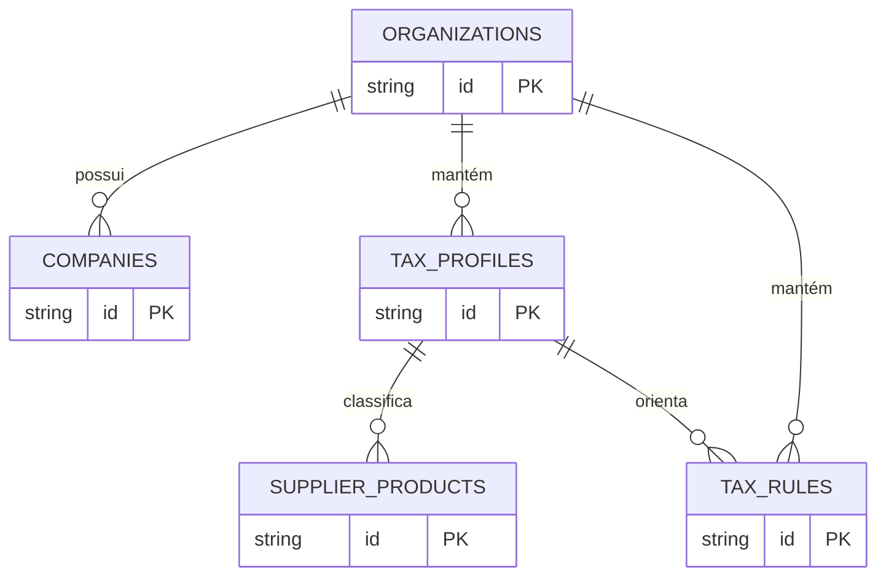
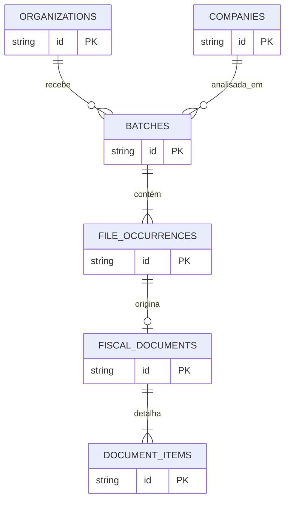
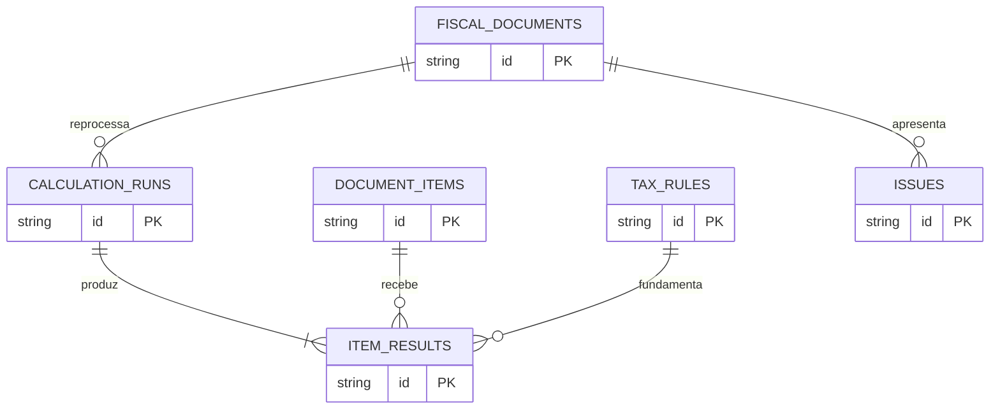
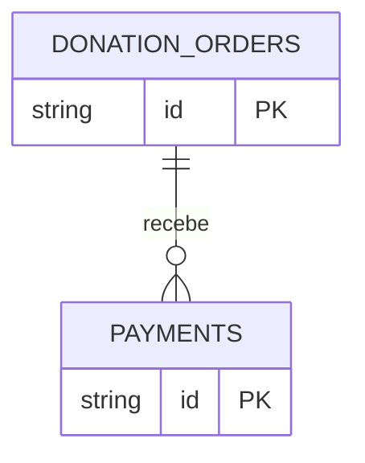

# Arquitetura do ContabiliNico

**Versão:** 0.2.0 — arquitetura acadêmica e implementação local-first

**Última atualização:** 11/10/2026

Este documento liga o vocabulário do [PRD](prd.md), as [jornadas](user-flows.md)
e o modelo de dados existente. A aplicação desktop continua processando XMLs,
cálculos, regras e histórico localmente. O backend acadêmico NestJS é uma nova
fronteira, limitada à criação de doações e à confirmação de pagamentos Stripe;
nenhum XML, dado fiscal ou resultado de cálculo é enviado a ele. Essa divisão
atende à stack exigida pela atividade sem transformar o processamento fiscal em
um serviço remoto.

## 1. Fontes e direcionadores

- `docs/prd.md`: atores, histórias, glossário e regras do produto.
- `docs/user-flows.md`: fluxos de importação e resolução de pendências.
- `docs/design-tokens.md`: decisões visuais da interface.
- `docs/modelo-de-dados.md` e `docs/decisoes-tecnicas.md`: persistência local e
  decisões fiscais já aprovadas.
- A atividade acadêmica fixa NestJS, Prisma e PostgreSQL e permite escolher
  React, Angular ou Vue para a interface.

Direcionadores mantidos: dados fiscais locais, cálculo determinístico e
reproduzível, regras versionadas, memória de cálculo auditável, falhas isoladas
por arquivo e nenhum serviço externo obrigatório para a conferência fiscal.

## 2. Stack

| Parte | Tecnologia e linha | Escopo e motivo |
| :--- | :--- | :--- |
| Interface desktop | Electron 38+ e Vue 3+ | A interface existente já usa Vue; a escolha reduz a troca de contexto e mantém o app instalável. |
| Linguagem | TypeScript 5.9+ | Compartilha tipos entre interface, pacotes locais e API. |
| Backend | NestJS 12+ | API REST apenas para o fluxo independente de doações e pagamentos. |
| Persistência da API | Prisma ORM 7+ e PostgreSQL 18+ | Registra pedidos de doação e eventos de pagamento no serviço da API. |
| Persistência fiscal local | SQLite | Mantém empresas, lotes, XMLs normalizados, regras, cálculos e histórico na instalação. |
| Integração de pagamento | Stripe API e webhooks | Processa a doação sem guardar dados de cartão e sem enviar dados fiscais. |
| Gerenciador de pacotes | pnpm 10+ | Já organiza o monorepo e seus pacotes de domínio. |
| Testes | Vitest 3+ | Já é o executor de testes do projeto. |
| Lint | Oxlint 1+ | Comando planejado para validar os pacotes da API e da interface. |

As linhas foram conferidas nas documentações oficiais em 11/10/2026. Prisma ORM
8 ainda estava em release candidate na data da consulta, então a linha estável
7 foi escolhida. Referências: [NestJS](https://docs.nestjs.com/migration-guide),
[Prisma](https://www.prisma.io/docs/orm/release-status),
[Vue](https://vuejs.org/guide/introduction),
[PostgreSQL](https://www.postgresql.org/about/news/postgresql-18-released-3142/).

Dependências de aplicação previstas para a API: `@nestjs/config`,
`@nestjs/swagger`, `class-validator`, `class-transformer`, `prisma`,
`@prisma/client`, `@prisma/adapter-pg`, `pg` e `stripe`. O validador global usa
`ValidationPipe`; os DTOs usam `class-validator` e `class-transformer`. Não há
autenticação de usuário no MVP: a instalação local não possui contas ou papéis,
e o fluxo de doação não cria uma conta. O endpoint de webhook valida a assinatura
do Stripe. Nenhuma biblioteca de UI, cliente HTTP ou autenticação adicional foi
escolhida.

## 3. Organização do repositório e camadas

O monorepo pnpm existente é estendido com a API. A API não importa diretamente
pacotes de persistência do desktop.

```text
apps/
  desktop/            Electron, Vue, preload e processo principal
  api/                NestJS; módulos de doação e pagamentos
packages/
  contracts/          contratos IPC existentes e tipos compartilhados seguros
  domain/             conceitos fiscais e estados independentes da interface
  nfe-parser/         inventário, segurança, parsing, XSD e normalização
  tax-engine/         seleção de regras e cálculo determinístico
  database/           persistência fiscal local em SQLite
  reporting/          modelo e exportação XLSX
  interchange/        importação e exportação de configurações
  payments/           contratos do fluxo de doação, sem dados fiscais
docs/                 PRD, jornadas, arquitetura e decisões
```

Fluxo fiscal: componente Vue → serviço da interface → IPC restrito → preload →
processo principal/workers → parser e domínio → motor fiscal → repositório SQLite
local → serviço de relatório. Componentes de interface não acessam o banco e não
falam diretamente com o servidor.

Fluxo de doação: componente Vue → serviço de doações → API REST NestJS → módulo
de doações/pagamentos → serviço Stripe e repositório Prisma → PostgreSQL. O
webhook Stripe entra pelo módulo de pagamentos, valida a assinatura e registra o
evento de forma idempotente. A API recebe somente identificador do pedido, valor,
moeda, estado e identificadores do gateway.

Na API, controllers traduzem HTTP para chamadas de serviço; services aplicam as
regras do fluxo; repositórios encapsulam Prisma. DTOs validam toda entrada. O
`ValidationPipe` global rejeita campos inválidos e desconhecidos. Um filtro global
converte erros não tratados para resposta HTTP estável, sem expor stack trace ou
segredos; erros de negócio usam códigos e mensagens acionáveis. Swagger documenta
os endpoints REST. O NestJS organiza essas responsabilidades em módulos por
domínio. No frontend, toda chamada remota passa pela camada de serviço.

## 4. Frontend

Vue 3+ permanece como framework de interface, dentro do renderer Electron. A
escolha se apoia na interface já implementada e na experiência acumulada no
projeto. Vue Router organiza navegação e Pinia guarda somente estado
compartilhado entre telas. Regras fiscais, cálculos e acesso a persistência
continuam fora de componentes e stores.

Electron mantém `contextIsolation` habilitado e Node.js indisponível no renderer.
O preload expõe apenas operações IPC explicitamente tipadas. Para a doação, a
interface usa um serviço Vue dedicado que conversa com a API; telas fiscais não
recebem cliente ou credenciais do Stripe.

## 5. Dados e ambientes

Os dados fiscais e o histórico pertencem ao SQLite de cada instalação. O
PostgreSQL guarda apenas pedidos de doação e pagamentos. Os dois armazenamentos
não são mesclados nem sincronizados. Valores monetários são decimais exatos; o
estado `pago` só é confirmado por webhook válido. Uma repetição do evento não
cria uma segunda confirmação.

| Ambiente da API | Onde roda | Conexão |
| :--- | :--- | :--- |
| Local | PostgreSQL em Docker na máquina de desenvolvimento | `DATABASE_URL` em `.env` fora do Git. O SQLite fiscal continua no diretório de dados da aplicação. |
| CI | PostgreSQL em container no GitHub Actions | `DATABASE_URL` definido pelo workflow para o serviço de teste. |
| Produção | Neon, região São Paulo | `DATABASE_URL` em secret da plataforma. |

O repositório contém somente o nome da variável. Valores de conexão e chaves do
Stripe vivem fora do Git. XMLs, CNPJ, regras, memória de cálculo e relatórios
fiscais nunca são enviados à API.

### Glossário técnico e modelo conceitual

| Termo de produto | Entidade/tabela | Dados principais |
| :--- | :--- | :--- |
| Organização | `organizations` (SQLite) | `id`, `name`, `installationId` |
| Empresa | `companies` (SQLite) | `id`, `organizationId`, `cnpj`, `legalName`, `state`, `status` |
| Perfil fiscal | `tax_profiles` (SQLite) | `id`, `organizationId`, `name`, `category`, `ncm`, `cest`, `version` |
| Produto de fornecedor | `supplier_products` (SQLite) | `id`, `supplierCnpj`, `supplierCode`, `taxProfileId`, `status` |
| Regra fiscal | `tax_rules` (SQLite) | `id`, `organizationId`, `version`, `validFrom`, `validTo`, `status`, `legalBasis` |
| Lote | `batches` (SQLite) | `id`, `organizationId`, `companyId`, `status`, `receivedAt` |
| Ocorrência de arquivo | `file_occurrences` (SQLite) | `id`, `batchId`, `contentHash`, `position`, `ingestionStatus` |
| Nota/documento fiscal | `fiscal_documents` (SQLite) | `id`, `batchId`, `fileOccurrenceId`, `accessKey`, `issuerCnpj`, `status` |
| Item da nota | `document_items` (SQLite) | `id`, `documentId`, `productCode`, `declaredValues` |
| Execução de cálculo | `calculation_runs` (SQLite) | `id`, `documentId`, `previousRunId`, `engineVersion`, `status` |
| Resultado do item | `item_results` (SQLite) | `id`, `calculationRunId`, `itemId`, `taxRuleId`, `calculatedValues`, `calculationMemory` |
| Pendência | `issues` (SQLite) | `id`, `batchId`, `documentId`, `itemId`, `type`, `status`, `resolution` |
| Pedido de doação | `donation_orders` (PostgreSQL) | `id`, `amount`, `currency`, `status`, `createdAt` |
| Pagamento | `payments` (PostgreSQL) | `id`, `donationOrderId`, `gatewayId`, `status`, `confirmedAt` |

“Horário de pico” é regra de negócio, não entidade. “Cancelamento” é estado ou
evento relacionado ao documento/pagamento e não ganha tabela genérica própria. O
produto não cadastra usuários nem papéis no MVP. Pedido e pagamento permanecem
separados porque um pedido pode continuar pendente, falhar, ser reembolsado ou
receber nova tentativa; o estado definitivo depende do gateway.

### Cadastros fiscais



| Entidade | Campos e relações |
| :--- | :--- |
| `ORGANIZATIONS` | `id` (PK), `name`, `installationId`; possui empresas, perfis fiscais e regras. |
| `COMPANIES` | `id` (PK), `organizationId` (FK), `cnpj`, `legalName`, `state`; pertence a uma organização. |
| `TAX_PROFILES` | `id` (PK), `organizationId` (FK), `name`, `ncm`, `cest`; pertence a uma organização e classifica produtos de fornecedores e regras. |
| `SUPPLIER_PRODUCTS` | `id` (PK), `supplierCnpj`, `supplierCode`, `taxProfileId` (FK); vincula produto de fornecedor a um perfil fiscal. |
| `TAX_RULES` | `id` (PK), `organizationId` (FK), `taxProfileId` (FK), `version`, `validFrom`, `validTo`, `status`; pertence à organização e pode seguir um perfil fiscal. |

### Ingestão fiscal



| Entidade | Campos e relações |
| :--- | :--- |
| `BATCHES` | `id` (PK), `organizationId` (FK), `companyId` (FK), `status`, `receivedAt`; pertence a uma organização e empresa e contém ocorrências de arquivo. |
| `FILE_OCCURRENCES` | `id` (PK), `batchId` (FK), `contentHash`, `position`, `ingestionStatus`; pertence a um lote e pode originar um documento fiscal. |
| `FISCAL_DOCUMENTS` | `id` (PK), `batchId` (FK), `fileOccurrenceId` (FK), `accessKey`, `issuerCnpj`, `status`; detalha-se em itens. |
| `DOCUMENT_ITEMS` | `id` (PK), `documentId` (FK), `productCode`, `declaredValues`; pertence a um documento fiscal. |

### Cálculo e pendências



| Entidade | Campos e relações |
| :--- | :--- |
| `FISCAL_DOCUMENTS` | `id` (PK), `accessKey`, `status`; documento processado nas execuções de cálculo. |
| `DOCUMENT_ITEMS` | `id` (PK), `documentId` (FK), `productCode`; item ao qual o resultado se refere. |
| `CALCULATION_RUNS` | `id` (PK), `documentId` (FK), `previousRunId` (FK), `engineVersion`, `status`; registra uma execução de um documento e pode suceder outra execução. |
| `ITEM_RESULTS` | `id` (PK), `calculationRunId` (FK), `itemId` (FK), `taxRuleId` (FK), `calculatedValues`; resultado de um item calculado com uma regra fiscal. |
| `TAX_RULES` | `id` (PK), `version`, `status`; regra fiscal usada no cálculo do item. |
| `ISSUES` | `id` (PK), `documentId` (FK), `type`, `status`, `resolution`; registra uma pendência relacionada ao documento. |

### Doações e pagamentos



| Entidade | Campos e relações |
| :--- | :--- |
| `DONATION_ORDERS` | `id` (PK), `amount`, `currency`, `status`; pedido que pode receber uma ou mais tentativas de pagamento. |
| `PAYMENTS` | `id` (PK), `donationOrderId` (FK), `gatewayId`, `status`, `confirmedAt`; tentativa vinculada a um pedido. |

As tabelas reúnem os domínios conceituais; as tabelas fiscais ficam no SQLite
local, enquanto `DONATION_ORDERS` e `PAYMENTS` ficam no PostgreSQL da API. O
modelo fiscal detalhado e suas restrições permanecem em
[`modelo-de-dados.md`](modelo-de-dados.md).

## 6. Mapa de domínios e comandos


## 7. Histórico
