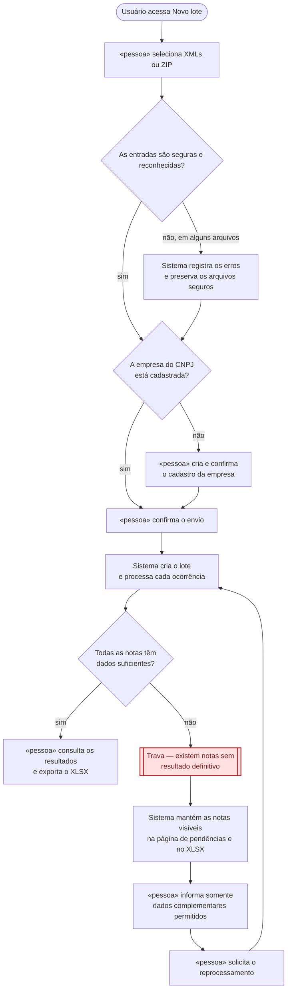
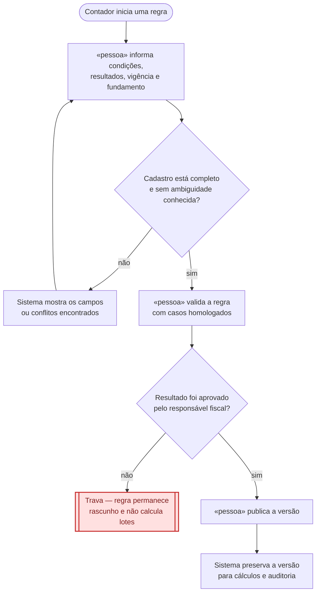
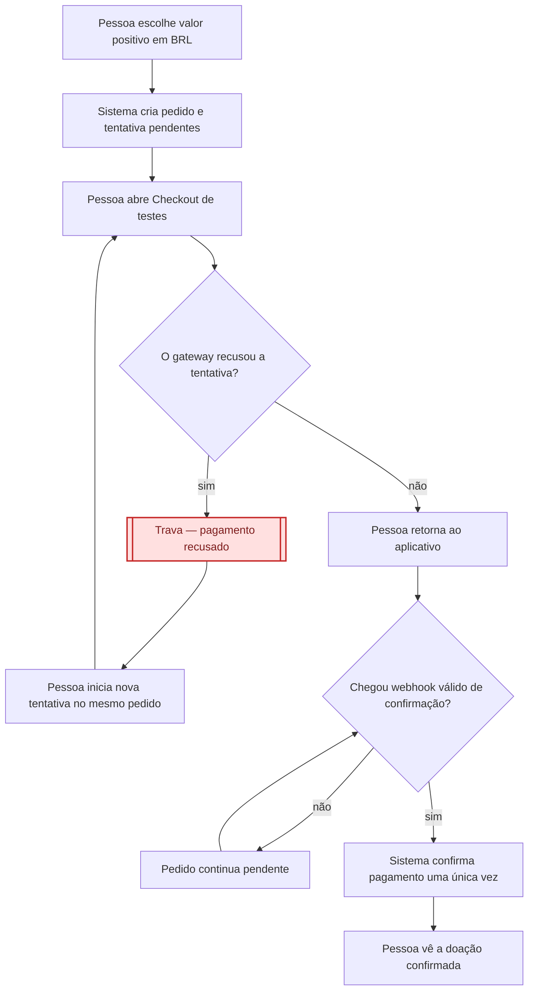

# Jornadas de Usuário

**Projeto:** ContabiliNico
**Versão:** 0.2.0 — revisão da Entrega 1
**Última atualização:** 11/10/2026

> Este documento descreve o que a pessoa vive durante as histórias mais críticas.
> Regras fiscais permanecem no PRD e em `regras-de-negocio.md`.

## Jornada 1 — Importar, processar e resolver um lote

**Stories:** [US03](prd.md#us03), [US04 — Draft](prd.md#us04), [US05](prd.md#us05), [US06](prd.md#us06) e [US07](prd.md#us07).
**Protótipo:** Novo lote → Conferência → Pendências → nova execução → prévia do XLSX.
**Critérios que ela marca:** depende do tempo; pode ser abandonada no meio.

**O que decidimos sobre o nó vermelho:** quando faltam informações, o sistema não
inventa valores e não esconde a nota. Ele calcula apenas o que for possível,
mantém a ocorrência na página de pendências e a apresenta no XLSX com o aviso
“Informações faltando”. Enquanto a pendência não for resolvida, a nota não compõe
o total definitivo. O usuário pode voltar posteriormente, informar apenas os
campos autorizados e solicitar um novo cálculo; o XML original e a execução
anterior permanecem preservados.

O protótipo permite explorar também a lista vazia, o CNPJ ainda não cadastrado,
um arquivo inválido, uma repetição e um conflito com justificativa. As decisões
correspondem aos critérios de US01, US03 e US06 e às regras RN-003, RN-024 e RN-035.

## Jornada 2 — Publicar uma regra fiscal sem alterar o passado

**Story:** [US02 — Criar e versionar regras fiscais](prd.md#us02).
**Protótipo:** Regras fiscais → criar rascunho → simular validação → publicar outra versão.
**Critérios que ela marca:** depende de outra pessoa agir; pode ser abandonada no meio.

**O que decidimos sobre o nó vermelho:** uma regra incompleta ou não homologada
permanece como rascunho e não participa da seleção usada pelos lotes. O contador
pode abandonar a edição e retomá-la depois, mas somente uma versão explicitamente
publicada e vigente pode afetar cálculos. Depois de publicada, uma correção cria
outra versão; o sistema não reescreve silenciosamente os resultados anteriores.

## Jornada 3 — Doar sem confundir intenção com pagamento

**Story:** [US09 — Fazer doação pelo Stripe](prd.md#us09).
**Protótipo:** Apoiar o projeto → criar pedido → simular recusa → nova tentativa → confirmação.

**Decisão no nó vermelho:** recusar uma tentativa não apaga o pedido nem o
histórico. A pessoa pode tentar novamente. O retorno do Checkout mantém o
pedido pendente; somente a confirmação válida muda seu estado para pago.
Repetir a mesma notificação não duplica a confirmação. São as regras RN-036 a
RN-039 do PRD. Os botões do protótipo simulam esses estados sem acessar Stripe.

## Dúvidas em aberto

| # | Dúvida | Onde precisa ser resolvida |
| :--- | :--- | :--- |
| 1 | O lote deve retomar automaticamente após o aplicativo ser fechado durante o processamento? | Decisão de recuperação e persistência no roadmap |
| 2 | Quais campos ausentes podem ser complementados manualmente? | Política fiscal de complementação |
| 3 | Quem homologa formalmente uma regra quando houver mais de um usuário na instalação? | Evolução de atores e permissões |
